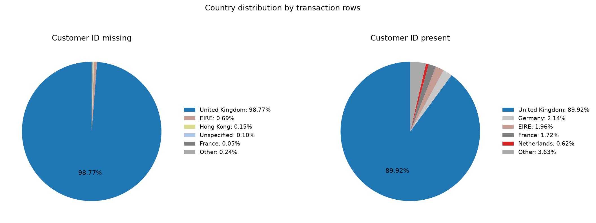

# Q1.2 揭示数据的真实结构

本报告由 q1_code.py 的 Q1.2 函数生成。实际字段为 Invoice、Price、Customer ID；保留所有原始行、空值、空格及重复记录。Amount = Quantity × Price，未换汇；数据未标明逐笔币种，不将计算结果直接认定为经过财务确认的收入。

全表 1,067,371 行；带符号净金额合计 19,287,250.568000；逐行金额绝对值合计 22,658,685.708000。

净金额占比 = 子集带符号金额 / 全表带符号金额；负占比表示净扣减。另列绝对金额占比用于观察抵消前规模，其分子是逐行绝对值之和，不是子集净额的绝对值。比例不能视为已清洗的销售额贡献。

## 1. Invoice 非纯数字前缀

| 前缀 | 出现次数 | 业务含义 |
| --- | --- | --- |
| A | 6 | 销售坏账记录（财务调整） |
| C | 19494 | 取消交易并退款的记录（1条正值待确认） |

出现次数按交易明细行计：A 出现6次，描述均为 Adjust bad debt；C 出现19494次，其中19493条 Quantity 为负，1条为正。C 的取消及退款含义是业务解释，实际资金退款状态仍需来源系统确认。

A 前缀的记录证据：

| Invoice | StockCode | Description | Quantity | Price | Amount |
| --- | --- | --- | --- | --- | --- |
| A506401 | B | Adjust bad debt | 1 | -53594.36 | -53594.36 |
| A516228 | B | Adjust bad debt | 1 | -44031.79 | -44031.79 |
| A528059 | B | Adjust bad debt | 1 | -38925.87 | -38925.87 |
| A563185 | B | Adjust bad debt | 1 | 11062.06 | 11062.06 |
| A563186 | B | Adjust bad debt | 1 | -11062.06 | -11062.06 |
| A563187 | B | Adjust bad debt | 1 | -11062.06 | -11062.06 |

C 前缀中正数量的例外（后续确认）：

| Invoice | StockCode | Description | Quantity | Price | Amount |
| --- | --- | --- | --- | --- | --- |
| C496350 | M | Manual | 1 | 373.57 | 373.57 |

**销售总额口径**：A 是财务调整，不应该算入销售总额；C 应按原始带符号金额如实加入销售净额计算，通常作为退款扣减，不能取绝对值累加。1条正值保留原符号并单列待确认。

支持代码：`q12_invoice()`，以 fullmatch 筛出非纯数字 Invoice，再提取前缀并统计行数。

## 2. StockCode 代码与业务解释

展示集合去掉纯数字、数字后接字母，以及仅由字母和数字组成的混合代码；保留纯字母、下划线、空格等特殊格式。C3、C2、ADJUST2、TEST001、TEST002 按人工指定名单作为例外保留。过滤只影响分析展示，不删除原始记录。整体占比已按当前展示集合重算，分母仍为全表。

| 代码数 | 行数 | 行数占比(%) | 净金额 | 净金额占比(%) |
| --- | --- | --- | --- | --- |
| 32 | 5983 | 0.5605361209926071 | -95847.932 | -0.49694969048115084 |

| StockCode | 行数 | 净金额 | 描述 | 行数占比(%) | 净金额占比(%) | 业务解释 |
| --- | --- | --- | --- | --- | --- | --- |
| '47503J ' | 1 | 16.13 | ['SET/3 FLORAL GARDEN TOOLS IN BAG'] | 9.36881365523328e-05 | 8.363037511817117e-05 | 商品代码末尾空格，描述为园艺工具 |
| 'ADJUST' | 67 | 6835.24 | ['Adjustment by john on 26/01/2010 16', 'Adjustment by john on 26/01/2010 17', 'Adjustment by Peter on 24/05/2010 1'] | 0.006277105149006298 | 0.03543916213408111 | 人工调整 |
| 'ADJUST2' | 3 | 731.0500000000001 | ['Adjustment by Peter on Jun 25 2010 '] | 0.0002810644096569984 | 0.003790327695606884 | 人工调整 |
| 'AMAZONFEE' | 43 | -260763.58 | ['AMAZON FEE'] | 0.00402858987175031 | -1.351999752793381 | Amazon平台费用 |
| 'B' | 6 | -147614.08000000002 | ['Adjust bad debt'] | 0.0005621288193139968 | -0.7653453740312294 | 销售坏账调整 |
| 'BANK CHARGES' | 102 | -35562.629 | [' Bank Charges', 'Bank Charges'] | 0.009556189928337944 | -0.18438412916666785 | 银行费用 |
| 'C2' | 282 | 13386.0 | ['CARRIAGE', ''] | 0.026420054507757848 | 0.06940336028095719 | 运输/运费（CARRIAGE） |
| 'C3' | 1 | 0.0 | [''] | 9.36881365523328e-05 | 0.0 | 缺失值，可能为记录出错 |
| 'CRUK' | 16 | -7933.43 | ['CRUK Commission'] | 0.0014990101848373248 | -0.0411330270845476 | CRUK佣金 |
| 'D' | 177 | -13484.539999999999 | ['Discount'] | 0.016582800169762903 | -0.06991426773068715 | 折扣 |
| 'DCGSLBOY' | 1 | 0.0 | [''] | 9.36881365523328e-05 | 0.0 | 缺失值，可能为记录出错 |
| 'DCGSLGIRL' | 1 | 0.0 | [''] | 9.36881365523328e-05 | 0.0 | 缺失值，可能为记录出错 |
| 'DCGSSBOY' | 23 | 251.35 | ['', 'update', 'BOYS PARTY BAG'] | 0.0021548271407036542 | 0.0013031924851799332 | 商品 |
| 'DCGSSGIRL' | 25 | 295.63 | ['', 'update', 'GIRLS PARTY BAG'] | 0.0023422034138083194 | 0.001532774196911652 | 商品 |
| 'DOT' | 1446 | 322647.47 | ['DOTCOM POSTAGE', ''] | 0.1354730454546732 | 1.6728536234983806 | 线上渠道邮费 |
| 'GIFT' | 1 | 0.0 | [''] | 9.36881365523328e-05 | 0.0 | 缺失值，可能为记录出错 |
| 'M' | 1421 | -82796.31999999999 | ['Manual'] | 0.1331308420408649 | -0.4292800557969087 | 手工记录 |
| 'PADS' | 19 | -36.583 | ['PADS TO MATCH ALL CUSHIONS'] | 0.001780074594494323 | -0.00018967452033155958 | 商品 |
| 'POST' | 2122 | 112341.0 | ['POSTAGE', ''] | 0.1988062257640502 | 0.5824624904619013 | 邮费 |
| 'S' | 104 | -6065.8 | ['SAMPLES'] | 0.00974356620144261 | -0.03144979103482968 | 样品 |
| 'TEST001' | 15 | 202.5 | ['This is a test product.'] | 0.0014053220482849918 | 0.0010499163646267614 | 测试商品，需核查是否测试交易 |
| 'TEST002' | 2 | 1.0 | ['This is a test product.', ''] | 0.0001873762731046656 | 5.184772170996353e-06 | 测试商品，需核查是否测试交易 |
| 'gift_0001_10' | 16 | 126.21 | ['Dotcomgiftshop Gift Voucher £10.00', ''] | 0.0014990101848373248 | 0.0006543700957014496 | 礼物券 |
| 'gift_0001_20' | 29 | 471.06 | ['Dotcomgiftshop Gift Voucher £20.00', '', 'to push order througha s stock was '] | 0.0027169559600176505 | 0.0024423387788695423 | 礼物券 |
| 'gift_0001_30' | 29 | 610.09 | ['Dotcomgiftshop Gift Voucher £30.00', ''] | 0.0027169559600176505 | 0.0031631776538031653 | 礼物券 |
| 'gift_0001_40' | 7 | 166.09 | ['', 'Dotcomgiftshop Gift Voucher £40.00'] | 0.0006558169558663296 | 0.0008611388098807843 | 礼物券 |
| 'gift_0001_50' | 8 | 253.59 | ['Dotcomgiftshop Gift Voucher £50.00', ''] | 0.0007495050924186624 | 0.0013148063748429652 | 礼物券 |
| 'gift_0001_60' | 2 | 0.0 | [''] | 0.0001873762731046656 | 0.0 | 缺失值，记录出错（人工待核查判断） |
| 'gift_0001_70' | 3 | 59.57 | ['', 'Dotcomgiftshop Gift Voucher £70.00'] | 0.0002810644096569984 | 0.0003088568782262527 | 礼物券 |
| 'gift_0001_80' | 4 | 0.0 | ['', 'Dotcomgiftshop Gift Voucher £80.00'] | 0.0003747525462093312 | 0.0 | 礼物券 |
| 'gift_0001_90' | 2 | 0.0 | [''] | 0.0001873762731046656 | 0.0 | 缺失值，记录出错（人工待核查判断） |
| 'm' | 5 | 15.049999999999999 | ['Manual'] | 0.0004684406827616639 | 7.80308211734951e-05 | 手工记录 |

表中“缺失值”指 Description 缺失，不是 StockCode 缺失。“记录出错”属于人工待核查判断，尚未依据该标签删除记录。PADS、DCGSSBOY、DCGSSGIRL 按商品解释；gift_0001_数字按礼物券解释，其中60、90单列为缺失描述记录。

支持代码：`stock_selection()`、`q12_stock()`、`code_meaning()`。

## 3. 可疑的极端值

### 数量极值完整记录

| 数据行序号 | Invoice | StockCode | Description | Quantity | InvoiceDate | Price | Customer ID | Country | Amount |
| --- | --- | --- | --- | --- | --- | --- | --- | --- | --- |
| 1065883 | 581483 | 23843 | PAPER CRAFT , LITTLE BIRDIE | 80995 | 2011-12-09 09:15:00 | 2.08 | 16446.0 | United Kingdom | 168469.6 |
| 1065884 | C581484 | 23843 | PAPER CRAFT , LITTLE BIRDIE | -80995 | 2011-12-09 09:27:00 | 2.08 | 16446.0 | United Kingdom | -168469.6 |

关联证据：同客户、同商品、同单价，时间间隔 12 分钟，合计金额 0.00，支持取消/冲销解释；初始大额下单是否录入错误仍需确认。

### 负价格完整记录

| 数据行序号 | Invoice | StockCode | Description | Quantity | InvoiceDate | Price | Customer ID | Country | Amount |
| --- | --- | --- | --- | --- | --- | --- | --- | --- | --- |
| 179404 | A506401 | B | Adjust bad debt | 1 | 2010-04-29 13:36:00 | -53594.36 |  | United Kingdom | -53594.36 |
| 276275 | A516228 | B | Adjust bad debt | 1 | 2010-07-19 11:24:00 | -44031.79 |  | United Kingdom | -44031.79 |
| 403473 | A528059 | B | Adjust bad debt | 1 | 2010-10-20 12:04:00 | -38925.87 |  | United Kingdom | -38925.87 |
| 825445 | A563186 | B | Adjust bad debt | 1 | 2011-08-12 14:51:00 | -11062.06 |  | United Kingdom | -11062.06 |
| 825446 | A563187 | B | Adjust bad debt | 1 | 2011-08-12 14:52:00 | -11062.06 |  | United Kingdom | -11062.06 |

负价格记录均为 A 前缀、StockCode B、Description 为 Adjust bad debt、Quantity 为1、Customer ID缺失、Country为United Kingdom，因此属于销售坏账财务调整。

**极端值处理建议**：C 类异常极值在确认确为错误交易及其取消冲销后，可从下游有效销售明细中删除对应的正负交易对；确认前保留。不能仅删除负向 C 行而保留原正向销售，否则会高估销售额。正常退款 C 记录仍按第1节如实参与净额计算。A 类坏账财务调整不可删除，应保留用于财务审计，并与商品销售额分开统计。本次不执行任何删除。

支持代码：`q12_extremes()`，使用 isin、merge 和时间差核对关联，不再输出关联宽表或同代码调整表。

## 4. Customer ID 缺失与非缺失对比

### 总体占比

| 客户组 | 总行数占比(%) | 总金额占比(%) | 净金额占比(%) |
| --- | --- | --- | --- |
| Customer ID缺失 | 22.766872999172733 | 16.859405656751075 | 13.682396932087185 |
| Customer ID非缺失 | 77.23312700082727 | 83.1405943432489 | 86.31760306791281 |

总金额定义为逐行 |Quantity × Price| 的合计，表示抵消前金额规模；净金额为带符号 Quantity × Price 合计。两种金额占比均以全表同口径金额为分母。保留取消、财务调整及重复记录。

### 表1：国家分布占比（组内明细行占比，%）

| Country | Customer ID缺失 | Customer ID非缺失 |
| --- | --- | --- |
| Australia | 0.0 | 0.2320576832564256 |
| Austria | 0.0 | 0.11378468734685164 |
| Bahrain | 0.027571222228166263 | 0.007157032572989601 |
| Belgium | 0.0 | 0.3788375038211276 |
| Bermuda | 0.013991366503845568 | 0.0 |
| Brazil | 0.0 | 0.01140272986205123 |
| Canada | 0.0 | 0.02765768519731575 |
| Channel Islands | 0.0 | 0.20185257968567283 |
| Cyprus | 0.0 | 0.1426554289124707 |
| Czech Republic | 0.0 | 0.003639169104909967 |
| Denmark | 0.0 | 0.09910670529038143 |
| EIRE | 0.6876345125860572 | 1.9645447884672305 |
| European Community | 0.0 | 0.007399643846650266 |
| Finland | 0.0 | 0.12724961303501853 |
| France | 0.05267337977918332 | 1.7227826542643783 |
| Germany | 0.0 | 2.1378905434977753 |
| Greece | 0.0 | 0.08042563721851026 |
| Hong Kong | 0.14978992374705255 | 0.0 |
| Iceland | 0.0 | 0.030690326118074054 |
| Israel | 0.019341006637668873 | 0.039303026333027645 |
| Italy | 0.0 | 0.18608284689772964 |
| Japan | 0.0 | 0.07059988063525335 |
| Korea | 0.0 | 0.00764225512031093 |
| Lebanon | 0.005349640133823306 | 0.00545875365736495 |
| Lithuania | 0.0 | 0.022926765360932792 |
| Malta | 0.0 | 0.03627038541226934 |
| Netherlands | 0.0 | 0.6235109733079076 |
| Nigeria | 0.0008230215590497394 | 0.003639169104909967 |
| Norway | 0.0 | 0.17649970158813338 |
| Poland | 0.0 | 0.06489851570422775 |
| Portugal | 0.04773525042488488 | 0.3037493146231519 |
| RSA | 0.018929495858144005 | 0.014920593330130865 |
| Saudi Arabia | 0.0 | 0.0012130563683033222 |
| Singapore | 0.0 | 0.04197175034329495 |
| Spain | 0.0 | 0.46229578196039617 |
| Sweden | 0.007818704810972523 | 0.16315608153679684 |
| Switzerland | 0.051438847440608705 | 0.37168047124813797 |
| Thailand | 0.0 | 0.009219228399105248 |
| USA | 0.0 | 0.06489851570422775 |
| United Arab Emirates | 0.04691222886583514 | 0.04682397581650824 |
| United Kingdom | 98.77452089857493 | 89.92398988796212 |
| Unspecified | 0.09547050084976975 | 0.06356415369909409 |
| West Indies | 0.0 | 0.006550504388837941 |



饼图分别展示两组前五国家，其余合并为 Other；完整国家比例见上表。

### 表2：客单价对比

| 客户组 | 客单价（原始净额发票均值） |
| --- | --- |
| Customer ID缺失 | 301.526300274223 |
| Customer ID非缺失 | 370.9843209733488 |

客单价 = 每组原始净金额 / 每组不同 Invoice 数。包含取消及调整发票，是原始净额发票均值，不是按客户计算的均值。

### 表3：高频商品/代码 TOP 10 对比

| 排名 | Customer ID缺失-StockCode | Customer ID缺失-行数 | Customer ID缺失-描述 | Customer ID非缺失-StockCode | Customer ID非缺失-行数 | Customer ID非缺失-描述 |
| --- | --- | --- | --- | --- | --- | --- |
| 1 | DOT | 1430 | ['DOTCOM POSTAGE', ''] | 85123A | 5322 | ['WHITE HANGING HEART T-LIGHT HOLDER', 'CREAM HANGING HEART T-LIGHT HOLDER'] |
| 2 | 85099B | 770 | ['JUMBO BAG RED WHITE SPOTTY ', 'RED RETROSPOT JUMBO BAG '] | 22423 | 3777 | ['REGENCY CAKESTAND 3 TIER'] |
| 3 | 22423 | 647 | ['REGENCY CAKESTAND 3 TIER', 'smashed'] | 85099B | 3446 | ['JUMBO BAG RED WHITE SPOTTY ', 'RED RETROSPOT JUMBO BAG '] |
| 4 | 21212 | 639 | ['PACK OF 72 RETRO SPOT CAKE CASES', 'PACK OF 72 RETROSPOT CAKE CASES'] | 84879 | 2794 | ['ASSORTED COLOUR BIRD ORNAMENT'] |
| 5 | 21931 | 635 | ['JUMBO STORAGE BAG SUKI'] | 20725 | 2755 | ['LUNCH BAG RED SPOTTY', 'LUNCH BAG RED RETROSPOT'] |
| 6 | 47566 | 624 | ['PARTY BUNTING', '?'] | 21212 | 2679 | ['PACK OF 72 RETRO SPOT CAKE CASES', 'PACK OF 72 RETROSPOT CAKE CASES'] |
| 7 | 22197 | 603 | ['POPCORN HOLDER , SMALL ', ''] | 21232 | 2190 | ['STRAWBERRY CERAMIC TRINKET BOX', 'STRAWBERRY CERAMIC TRINKET POT'] |
| 8 | 22379 | 573 | ['RECYCLING BAG RETROSPOT '] | 20727 | 2161 | ['LUNCH BAG  BLACK SKULL.'] |
| 9 | 22355 | 572 | ['CHARLOTTE BAG , SUKI DESIGN', 'CHARLOTTE BAG SUKI DESIGN'] | 21034 | 2150 | ['REX CASH+CARRY JUMBO SHOPPER'] |
| 10 | 20724 | 566 | ['RED SPOTTY CHARLOTTE BAG', 'RED RETROSPOT CHARLOTTE BAG'] | 47566 | 2144 | ['PARTY BUNTING'] |

使用全部原始行，按 StockCode 出现明细行数排名，不筛选正向交易、不去重。保留邮费等非商品代码供对照，不将其误称为商品；相同频次按代码排序。

**解读**：匿名组英国集中度更高；原始净额发票均值低于非缺失组。高频代码及描述显示商品与渠道相关记录的差异，但不能只凭ID缺失判断是散客或低价值客户。匿名记录可能与未登记客户、线上渠道或历史缺录有关，仍需渠道信息确认。

支持代码：`q12_customers()`、`country_pies()`，使用 groupby、crosstab 与按组发票金额均值计算。

## 复现方式与代码定位

```bash
conda activate gekko-de
python q1_data_quality/q1_code.py --only-q12
```

不加 --only-q12 时重现 Q1.1 和 Q1.2。支持代码在同目录 q1_code.py 中，函数名称与上述四步一一对应；不调用 df.describe()。

### 核心支持代码（data 是原始数据的分析副本）

```python
# 1. 非纯数字发票和前缀
unusual = data.loc[~data['Invoice'].str.fullmatch(r'[0-9]+')].copy()
unusual['prefix'] = unusual['Invoice'].str.extract(r'^([^0-9]+)', expand=False).fillna('无前导非数字字符')
print(unusual.groupby('prefix')['Invoice'].agg(['size', 'nunique']))

# 2. 不符合常规格式的商品代码与金额占比
mask = stock_selection(data)
print(data.loc[mask].groupby('StockCode')['Amount'].agg(['size', 'sum']))
print(data.loc[mask, 'Amount'].sum() / data['Amount'].sum())

# 3. 数量极值、负价格记录
print(data.loc[data['Quantity'].isin([80995, -80995])])
print(data.loc[data['Price'].lt(0)])

# 4. 客户缺失占比、每发票净额
missing = missing_mask(data['Customer ID'])
print(missing.mean(), data.loc[missing, 'Amount'].sum() / data['Amount'].sum())
print(data.assign(missing=missing).groupby(['missing', 'Invoice'])['Amount'].sum().groupby(level=0).mean())
```

业务含义为结合当前描述与数值的推断，不是来源系统已验证的标签。输入数据变化后，应重新审阅文字解读。
