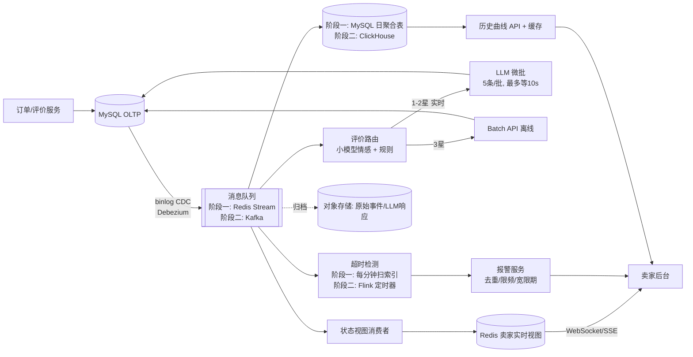

# Q5.1 - 实时数据管道设计

## 📋 题目背景

Olist 当前的数据是离线 CSV 导出。现在业务需求是——卖家希望**实时**看到自己的订单情况、买家评价、物流异常。

请设计一个**实时数据架构**，满足：

- 订单状态变更后 **30 秒内** 反映在卖家后台
- 评价文本进来后 **1 分钟内** 触发情感分析 + LLM 抽取
- 物流异常（如某订单延迟超过预计时间）**自动报警**到卖家
- 历史数据查询（卖家想看过去 6 个月的成交曲线）**毫秒级响应**
- 当前数据规模：**10 万订单/天**，预计 2 年内增长到 **100 万订单/天**

要求：800-1500 字 + 一张架构图

> 本文所有比例均由 `q5_baseline_stats.py` 从 Olist 原始数据算出（结果在 `baseline_stats.json`），LLM 单价引用 Q4 v6 实测。

---

## 0. 先算量，再选型

| 指标（Olist 实测） | 值 | 用在哪 |
|---|---|---|
| 每单评价数 | 0.998 | 评价量 ≈ 订单量 |
| 评价有文本 | 41.3% | LLM 漏斗 |
| ≤3 星且有文本 | 14.6% | LLM 漏斗 |
| 其中 ≤3 词短评 | 仅 7.1% | 规则分流收益有限 |
| 延迟送达率（Q2 口径） | 8.1% | 报警量 |
| 卖家交承运商超时率 | 9.1% | 报警量 |
| 每单里程碑事件（下限） | 3.95 | 事件量 |
| 高峰日 / 平均日 | 6.1 倍（2017-11-24 黑五） | 容量规划 |
| 高峰小时 / 平均小时 | 13.0 倍 | 容量规划 |

按以上比例推算：10 万单/天的高峰小时约 15 单/秒、60 条事件/秒；100 万单/天约 150 单/秒、600 条事件/秒。**10 万/天单台 MySQL 足够，不需要一开始就上流处理集群**，所以下面分两阶段设计。

## 1. 整体架构图

各需求的实现：

- **30 秒可见**：CDC 约 1s，队列毫秒级，消费者 1–2s，推送 1s。延迟预算合计不到 5s，剩下的余量留给重试。
- **1 分钟抽取**：复用 Q4 分流和 Prompt。Q4 实测 4 并发处理 20 条用时 5.8s，微批最多等 10s，能满足 1 分钟要求。
- **物流报警**：延迟是**某个事件一直没有发生**，没有消息来触发它，所以必须靠定时器主动检查。设两类报警：① 已过 `order_estimated_delivery_date` 仍未送达；② 已过 `shipping_limit_date` 仍未交给承运商。②是卖家自己能处理的问题，价值更高。
- **毫秒级历史查询**：关键在预聚合，数据库换哪个是次要的。`seller_daily_gmv(seller_id, day)` 每个卖家 6 个月只有约 180 行，按主键查询就是毫秒级。GMV 口径同 Q2（delivered，price+freight）。

## 2. 数据存储选型

| 存储 | 放什么 | 为什么 |
|---|---|---|
| OLTP（MySQL） | 订单、明细、评价、LLM 抽取结果（Q4 `schema.sql`）、报警状态 | 需要事务和逐行更新，作为唯一事实来源 |
| 消息队列 | CDC 事件、评价事件、报警事件、死信 | 解耦各消费者；下游出错后可回放重算 |
| OLAP | 销售事实表、卖家日聚合 | 大范围扫描聚合。阶段一用 MySQL 汇总表，阶段二用 ClickHouse |
| 缓存（Redis） | 卖家当天计数、最近订单、评价文本 hash 到 LLM 结果的映射 | 后台高频读；重复文本不再调用 LLM |
| 对象存储 | 原始事件、LLM 原始响应和账本 | 审计和重放，沿用 Q4 的账本做法 |

## 3. LLM 部分如何避免成本失控

单价按 Q4 v6 实测计：每条约 324 输入 token、116 输出 token，gpt-4.1-mini 约 **$0.000314/条**。100 万单/天的成本漏斗如下：

| 策略 | 调用/天 | 年成本 |
|---|---:|---:|
| A 每条评价都过 LLM | 99.8 万 | **$114,455** |
| B 只处理有文本的 | 41.2 万 | $47,236 |
| C 只处理 ≤3 星且有文本 | 14.5 万 | $16,665 |
| D 再剔除 ≤3 词短评 | 13.5 万 | $15,486 |
| E 再做精确去重 | 12.7 万 | **$14,583** |

如果换成单价约 5 倍的更大模型，A 方案会达到约 $57 万/年。进一步优化：

1. **按 SLA 分级**：只有 1–2 星（占评价 11.0%）走实时；3 星（3.6%）走 Batch API，价格减半。
2. **Prompt 缓存**：Q4 持续测试中缓存输入占 80%，固定的系统提示词放在请求前缀。
3. **4 星以上只用小模型打情感分**，不调用 LLM。
4. **每日预算熔断**：超过上限后降级为只用规则，未处理的评价积压等次日 Batch 补跑。

**数据纠正了我原来的假设**：我以为大量差评只有 "ruim" 一个词、可以走规则，实测这类短评只占 7%。真正省钱的是按星级和文本筛选，规则分流的收益很小。

## 4. 三个最大的风险点和应对方式

### 风险 1：LLM 成本、限流或质量失控

**说明**：刷评或大促会让评价量暴涨。按 100 万单/天的高峰小时算，约 20 条/秒，相当于 240 RPM、53 万 TPM，远超 Q4 试点时的 60 RPM / 10 万 TPM 门限。模型质量也可能漂移：Q4 的 H23 样本连跑 12 轮都没通过。

**应对**：按星级设优先级队列，积压时先处理 1 星；配置备用服务商；预算熔断；每天固定抽样人工复核，复核结果不达标时回滚 Prompt 版本。

### 风险 2：事件乱序、重复和状态回退

**说明**：CDC 投递语义是"至少一次"，消息可能重复或乱序。订单状态也会回退，比如已开票后又取消。这会让实时 GMV 和 Q2 的离线口径对不上。

**应对**：以 `(order_id, status, event_ts)` 作为幂等键，按事件时间做版本比较，旧事件不覆盖新状态；聚合表支持重算当天分区；每天凌晨把实时聚合与 MySQL 对账，差异超过阈值就告警并以离线结果为准。

### 风险 3：报警误报和报警风暴

**说明**：实测 `order_estimated_delivery_date` 100% 都是 00:00:00，只精确到天，而巴西有多个时区。按时间戳比较，延迟率是 8.1%；按天比较只有 6.8%。也就是说约 1.3% 的订单只是当天晚些送达，却会被误报。数据集截止时，还有 1,737 单未送达却已超过预计日期，系统上线第一天就会集中报出来。

**应对**：按"卖家所在时区的当天结束"判断超时，再加宽限期；同一订单只报一次，单个卖家的报警限频，多条合并成摘要推送；上线时存量异常只生成报表，不逐条推送；卖家可以标记"误报"，用来回调阈值。

**其他局限**：Olist 没有物流轨迹数据，"运输途中停滞"这类异常需要接入承运商数据；头部卖家流量集中，按 `seller_id` 分区会有数据倾斜。

---

## 5. 关于业务规模变化的考虑

| | 10 万/天（阶段一） | 100 万/天（阶段二） |
|---|---|---|
| 消息队列 | Redis Stream 或直接消费 CDC | 托管 Kafka，按 `order_id` 分区 |
| 超时检测 | 每分钟扫一次 `(status, estimated_date)` 索引 | Flink 按 key 的定时器 |
| 历史查询 | MySQL 日聚合表 | ClickHouse 物化视图 + 缓存 |
| LLM | 约 1.3 万条/天，约 $1,500/年，全部实时也可以 | 必须分级、加缓存、设熔断 |

迁移不按订单量拍板，而是看指标：定时扫描耗时超过 10s、汇总表写入出现锁等待，或主库 CPU 持续超过 60% 时再升级。阶段一的组件更少，运维成本也更低。它的局限是 MySQL 同时承担 OLTP 和汇总表，大促时两者会互相影响，所以黑五（6 倍日均）前需要做一次压测。

---

## 评分参考

| 维度 | 关注什么 |
|------|----------|
| 是否罗列技术栈 | 不要只说"用 Kafka + Flink + ClickHouse + Redis" |
| 是否解释为什么 | 每个选型需要说明业务原因 |
| 成本意识 | 10 万 vs 100 万的方案应该不同 |
| 风险预判 | 主动指出方案的局限性 |
